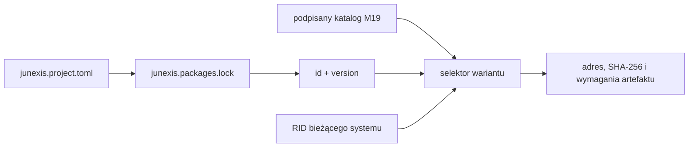

# M19.10.1 — logiczna zależność i wybór wariantu RID

## Reguła

Projekt blokuje logiczną zależność przez parę:

```text
id + version
```

RID nie jest częścią tej tożsamości. Dopiero podczas odtwarzania środowiska
selektor łączy logiczną zależność z wpisem zweryfikowanego katalogu M19:

```text
id + version + RID -> dokładny artefakt
```



Ten sam `junexis.project.toml` i ten sam `junexis.packages.lock` pozostają
przenośne między Windows x64, Linux x64 i macOS arm64. Wynik fizycznego wyboru
jest danymi wykonawczymi i nie jest zapisywany z powrotem do pliku blokady.

## Granice bezpieczeństwa

`PlatformVariantSelector`:

- wymaga katalogu `junexis.platform-release-catalog/0.2`;
- wybiera dokładnie zgodne `id`, `version` i RID;
- nie wraca do wariantu innego systemu;
- odrzuca powtórzony wariant, sprzeczny system lub architekturę;
- wymaga artefaktu z HTTPS, poprawnymi odciskami pochodzenia i SBOM;
- odrzuca wariant wycofany albo bez zweryfikowanego podpisu systemowego.

Sprawdzenie kryptograficznego podpisu całego katalogu pozostaje wcześniejszą
bramką M18. Selektor nie przedstawia samego pola `signature` jako dowodu
autentyczności.

## Dowód

```powershell
pwsh -File scripts/verify-m19-10-1.ps1 -NoRestore
```

Bramka uruchamia sześć prób: wybór Windows i Linux przy niezmiennym pliku
blokady, odrzucenie pola RID w tej blokadzie, brak powrotu do obcego RID-u,
odrzucenie duplikatu, wymaganie dokładnej wersji oraz odrzucenie sprzecznego lub
niezweryfikowanego wariantu.
