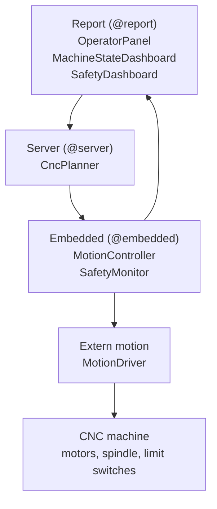
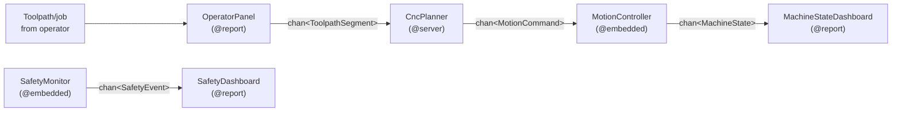
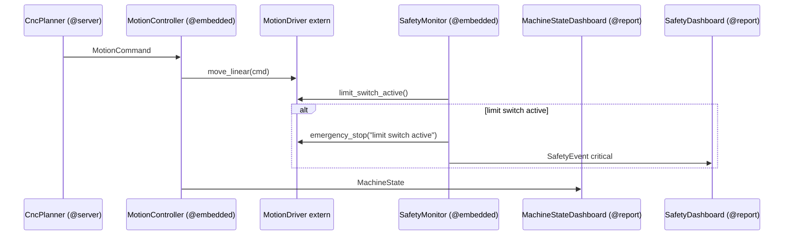
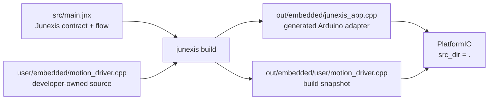

# 33 — CNC control demo

Status: **concept / safety-oriented demo / not for real machine control**

Ten przykład pokazuje, jak Junexis może opisywać system sterowania CNC:

- `@report` — panel operatora i podgląd zdarzeń,
- `@server` — planner i walidacja ruchu,
- `@embedded` — granica do sterownika ruchu,
- `device` — charakter sprzętu CNC,
- `pipeline` — przepływ job → planner → motion controller → dashboard,
- `extern motion` — developer-owned kod sterownika,
- `narrative` — jawna historia bezpieczeństwa i ograniczeń.

## Obraz systemu



Ten przykład nie próbuje ukryć granic platformy. Junexis opisuje przepływ,
kontrakt i obserwowalność, ale realny sterownik ruchu pozostaje po stronie
developera.

## Przepływ sterowania



Najważniejsza granica:

```junexis
extern motion MotionDriver {
    target embedded
    language cpp
    file "user/embedded/motion_driver.cpp"

    fn move_linear(cmd: MotionCommand)
    fn emergency_stop(reason: Text)
}
```

Junexis opisuje kontrakt, przepływ i obserwowalność. Rzeczywiste sterowanie
silnikami, timingi kroków, akceleracje, krańcówki i e-stop należą do kodu
developera oraz sprzętowej warstwy bezpieczeństwa.

## Granica `extern motion`



## Ostrzeżenie bezpieczeństwa

Ten przykład nie jest firmware do realnej maszyny CNC. Realne CNC wymaga:

- sprzętowej ścieżki emergency stop,
- certyfikowanej lub dokładnie przetestowanej kontroli ruchu,
- limitów prędkości, przyspieszeń i obszaru pracy,
- testów na symulatorze przed kontaktem z maszyną,
- analizy ryzyka dla konkretnej maszyny.

## Sprawdzenie

```powershell
dotnet run --project ../../../compiler/JunexisLang.Compiler.CLI -- check
dotnet run --project ../../../compiler/JunexisLang.Compiler.CLI -- doctor
dotnet run --project ../../../compiler/JunexisLang.Compiler.CLI -- extern scaffold
dotnet run --project ../../../compiler/JunexisLang.Compiler.CLI -- build
```

Aktualny stan weryfikacji przykładu:

```powershell
dotnet run --project ../../../compiler/JunexisLang.Compiler.CLI -- check --json
dotnet run --project ../../../compiler/JunexisLang.Compiler.CLI -- compile --json
dotnet run --project ../../../compiler/JunexisLang.Compiler.CLI -- artifact-gate --target server
dotnet run --project ../../../compiler/JunexisLang.Compiler.CLI -- artifact-gate --target report
dotnet run --project ../../../compiler/JunexisLang.Compiler.CLI -- artifact-gate --target embedded
```

Oczekiwany wynik:

- `check` przechodzi,
- `compile` generuje artefakty dla `server`, `report` i `embedded`,
- `artifact-gate server` sprawdza kontrakt artefaktów i kompilację Go,
- `artifact-gate report` sprawdza kontrakt artefaktów i kompilację TypeScript,
- `artifact-gate embedded` sprawdza kontrakt artefaktów i build PlatformIO,
- diagnostyki `NO_FILE_IO`, `CORS` i `MEMORY_LIMIT` dla `@report` są informacyjne
  i wynikają z profilu przeglądarki, nie z błędu CNC.

Jeżeli native toolchain gate nie przechodzi, najpierw sprawdź lokalne narzędzia:

- Go musi umieć wykonać `go list fmt`,
- npm musi mieć zapisywalny cache,
- PlatformIO musi być dostępne jako `pio` albo podane jawnie przez
  `--platformio-exe`.

Przykład jawnego PlatformIO z lokalnego środowiska audytowego:

```powershell
dotnet run --project ../../../compiler/JunexisLang.Compiler.CLI -- artifact-gate --target embedded --platformio-exe ../../../.m4-platformio/Scripts/pio.exe
```

W tym przykładzie wszystkie trzy artifact-gate targety są przechodnie, gdy
lokalne toolchainy mają dostęp do swoich cache/katalogów użytkownika.

`extern scaffold` tworzy brakujący plik `user/embedded/motion_driver.cpp`
dla kontraktu `extern motion MotionDriver`. Jeśli plik już istnieje, komenda go
pomija i nie nadpisuje kodu developera.

Podczas builda plik:

```text
user/embedded/motion_driver.cpp
```

jest dołączany jako snapshot:

```text
out/embedded/user/motion_driver.cpp
```

Ponieważ wygenerowany `platformio.ini` ma `src_dir = .`, PlatformIO widzi kod
developera w build tree. Źródłem prawdy pozostaje `user/embedded`.



`out/` i `.junexis/` są generowane lokalnie i nie powinny być commitowane.
`user/` jest kodem developera i powinien być wersjonowany.

## Jak czytać ownership plików

```text
src/main.jnx
```

To źródło prawdy Junexis: typy, taski, device, pipeline, narrative oraz kontrakt
`extern motion`.

```text
user/embedded/motion_driver.cpp
```

To kod developera. Generator może go skopiować do build tree, ale nie powinien
go nadpisywać. Tutaj należy implementować realny adapter do HAL/sterownika
ruchu, symulatora albo mocka testowego.

```text
out/
.junexis/
```

To artefakty lokalne. Mogą zostać usunięte przez `Junexis: Clean Project` albo
ponownie wygenerowane przez `Junexis: Build Project`.

Najważniejsza zasada przykładu: Junexis opisuje architekturę i granice
odpowiedzialności, ale nie przejmuje certyfikowanej logiki kontroli ruchu.
