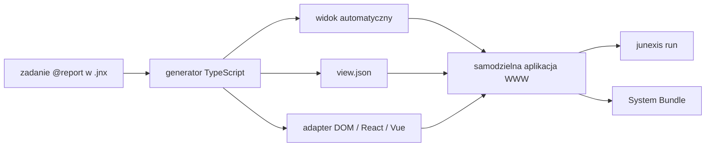

# Junexis Lang — aplikacja TypeScript dla `@report`

> **Kamień milowy:** M10
> **Status:** VERIFIED — M10.1–M10.10
> **Zakres:** `@report` → samodzielna aplikacja przeglądarkowa
> **Data decyzji:** 2026-08-13
> **Data odbioru:** 2026-08-21

## Cel

`@report` nie może kończyć się na skompilowanym kliencie TypeScript, który
wypisuje odebrane wartości do konsoli. Użytkownik ma otrzymać działającą,
czytelną aplikację przeglądarkową, która pokazuje stan systemu i uczciwie
prezentuje stan komunikacji.

> **Kontrakt M10:** poprawny projekt z zadaniem `@report` buduje samodzielny
> artefakt WWW, a `junexis run` otwiera panel bez ręcznego tworzenia HTML,
> bundlera lub kodu startowego.

M10 rozszerza istniejący backend TypeScript. Nie zmienia znaczenia
`chan<T>`, `queue<T>` ani `stream<T>` i nie przenosi logiki domenowej z zadań
serwerowych do interfejsu.

## Zweryfikowany rezultat

M10 rozpoczął się od generatora, którego domyślny konsument kończył na
`console.log(item)`. Ten stan był punktem wyjścia, nie aktualną granicą.
Bieżący generator zapewnia:

- typy TypeScript,
- wykonywanie instrukcji zadania `@report` w obsługiwanym zakresie,
- lokalny runtime komunikacji,
- WebSocket + MessagePack dla `@server → @report`,
- ponowne łączenie z narastającym opóźnieniem,
- kompletną aplikację WWW z automatycznym rendererem,
- walidowany widok deklaratywny,
- adaptery autora dla DOM, React i Vue,
- jawny lifecycle połączenia i ograniczoną historię,
- uruchamianie projektu oraz pakowanie gotowego bundle.



## Odpowiedzialności

| Warstwa | Odpowiedzialność |
|---|---|
| zadania domenowe | obliczenia, decyzje, stan systemu i skutki |
| `@report` | projekcja danych dla człowieka oraz dozwolone intencje użytkownika |
| transport | dostarczenie, wersja kontraktu, reconnect i backpressure |
| generator aplikacji | HTML, uruchomienie, layout, dostępność i stany techniczne |

Panel nie może samodzielnie uznawać ostatniej wartości za aktualną, gdy
transport jest rozłączony. Musi odróżniać co najmniej:

- oczekiwanie na pierwsze dane,
- połączenie aktywne,
- dane odebrane,
- połączenie przerwane,
- ponowne łączenie,
- niezgodną wersję kontraktu,
- błąd renderowania lub adaptera użytkownika.

## Trzy poziomy użytkownika

### Początkujący — bezpieczny panel automatyczny

Samo zadanie:

```junexis
task HomeReport(observations: chan<HomeObservation>) @report {}
```

tworzy gotową stronę zawierającą:

- nazwę raportu,
- kartę statusu połączenia,
- ostatnią odebraną wartość z nazwami pól,
- czas ostatniej aktualizacji,
- historię ograniczoną bezpiecznym limitem,
- czytelny stan pusty i stan błędu.

Generator wybiera zachowawczy układ na podstawie typów. Nie zgaduje znaczenia
biznesowego koloru czerwonego, alarmu ani działania urządzenia.

### Średniozaawansowany — deklaratywna projekcja

Użytkownik wybiera widoki, formaty, grupowanie i dozwolone działania bez
przejmowania infrastruktury aplikacji. Docelowy kontrakt powinien móc opisać:

- wartość bieżącą,
- tabelę,
- serię czasową,
- status i alert,
- filtr oraz wybór zakresu,
- formularz wysyłający typowaną intencję do zadania serwerowego.

Ostateczna składnia deklaracji widoku zostanie zamrożona dopiero po pionowym
prototypie. M10 nie wprowadzi słów kluczowych bez AST, Semantic IR, codegenu i
testu przeglądarkowego.

Pierwszy pion nie dodaje jeszcze składni języka. Używa wersjonowanego opisu
projektowego `user/report/view.json`:

```json
{
  "$schema": "junexis.report-view/0.1",
  "title": "Stan domu",
  "layout": "grid",
  "panels": [{
    "task": "HomeReport",
    "title": "Warunki",
    "fields": [
      { "path": "temperature", "label": "Temperatura", "format": "number", "unit": "°C" },
      { "path": "occupied", "label": "Obecność", "format": "boolean" }
    ]
  }]
}
```

`junexis report scaffold --declarative` wyprowadza listę paneli z rzeczywistych
zadań `@report`. Build odrzuca nieznane zadania, duplikaty, obce pola schematu,
niebezpieczne ścieżki i nieobsługiwane formaty. Pusta lista `fields` renderuje
całą wartość bezpiecznym rendererem automatycznym. Konfiguracja może więc
rosnąć pole po polu bez utraty działającego panelu.

### Ekspert — własna aplikacja

Ekspert może zastąpić domyślny renderer własnym interfejsem React, Vue lub
innym klientem, ale korzysta z tego samego:

- wygenerowanego kontraktu typów,
- klienta transportu,
- lifecycle połączenia,
- wersji wire contract,
- Build ID i Bundle ID,
- punktów Narrative i observability.

Własny interfejs jest adapterem użytkownika, a nie rozwidleniem semantyki
`@report`.

Kontrakt adaptera pozostaje framework-neutralny, ale scaffold może utworzyć
gotowy punkt wejścia DOM, React albo Vue:

```text
user/report/adapter.ts                 # własność autora
user/report/package.json               # opcjonalne, kontrolowane zależności
        ↓ snapshot podczas build
out/report/user-adapter.ts             # kompilowana kopia
out/report/user-package.json           # dowód wejściowej konfiguracji
out/report/report-adapter-contract.ts   # generowany kontrakt
out/report/package.json                 # wynik bezpiecznego scalenia
```

Polecenie `junexis report scaffold` tworzy bezpieczny starter tylko wtedy, gdy
plik autora jeszcze nie istnieje. Hooki `mount`, `onObservation` i
`onConnection` pozwalają przejąć widok, dane i lifecycle. Zwrócenie `true` z
`mount` albo `onObservation` oznacza jawne przejęcie renderowania. Wyjątek
adaptera staje się widocznym błędem panelu, a automatyczny renderer pozostaje
fallbackiem.

`junexis report scaffold --framework react` i wariant `vue` deklarują
zależności przez `junexis.report-package/0.1`. Kontrakt dopuszcza wyłącznie
`dependencies` i `devDependencies`; nie pozwala przejąć skryptów budowania ani
zmienić wersji zależności należącej do generatora. Oryginalny manifest autora
pozostaje w inventory jako `user-overlay`, a wynikowe `package.json` jest
generowanym, powtarzalnym scaleniem.

## Artefakt

Kluczowe pliki wyniku `junexis build` to:

```text
out/report/
├── index.html
├── index.ts
├── browser.ts
├── runtime.ts
├── types.ts
├── deploy.ts
├── report-view.ts
├── report-view-contract.ts
├── user-view.ts
├── report-adapter-contract.ts
├── user-adapter.ts
├── report.css
├── package.json
├── tsconfig.json
├── serve.mjs
└── junexis-report-manifest.json
```

Materializacja wykonywana podczas `junexis package` buduje bundle i dodaje
minimalny katalog `runtime/` z `index.html`, `report.css`, `serve.mjs`,
manifestem oraz `dist/browser.js`. Ta część paczki nie wymaga checkoutu
źródeł, kompilatora TypeScript ani bundlera.

Manifest raportu zapisuje:

- wersję kontraktu aplikacji,
- zadania `@report` i ich wejścia,
- tryb renderera: automatyczny, deklaratywny albo użytkownika,
- zgodny wire contract,
- Build ID i Bundle ID,
- inventory generowanych i należących do użytkownika plików,
- wymagania runtime i politykę Content Security Policy.

Generator nie nadpisuje plików oznaczonych jako własność użytkownika.

## Uruchomienie

Docelowy rytuał publiczny:

```powershell
junexis check dom-junexis
junexis build dom-junexis
junexis run dom-junexis
```

`run` powinno:

1. uruchomić wymagane targety projektu,
2. przydzielić bezpieczny lokalny adres panelu,
3. przekazać dokładny adres serwera bez wpisywania go do kodu,
4. poczekać na gotowość aplikacji w ograniczonym czasie,
5. podać użytkownikowi adres panelu,
6. kontrolowanie zamknąć własne procesy.

Pakiet systemu zawiera statyczny, produkcyjny bundle raportu. Publiczne
wdrożenie nie wymaga serwera deweloperskiego bundlera.

## Bezpieczeństwo i dostępność

Automatyczny panel musi:

- kodować tekst zamiast wstrzykiwać HTML z danych,
- posiadać restrykcyjną domyślną Content Security Policy,
- nie umieszczać sekretów ani danych połączenia w bundle,
- odrzucać obcą wersję wire contract,
- ograniczać historię i rozmiar renderowanych danych,
- działać z klawiaturą,
- mieć widoczny fokus i semantyczne etykiety,
- spełniać kontrast co najmniej WCAG AA,
- respektować ograniczenie animacji,
- nie ukrywać rozłączenia za ostatnim poprawnym stanem.

## Etapy M10

| Etap | Rezultat | Dowód |
|---|---|---|
| M10.1 | ✅ `junexis.report-application/0.1` i manifest | walidacja schematu i deterministyczny hash |
| M10.2 | ✅ przeglądarkowy scaffold HTML/TS/CSS | natywny build artefaktu bez ręcznych plików |
| M10.3 | ✅ automatyczny i deklaratywny renderer typów | struct, enum, lista i wartości opcjonalne oraz walidowany widok pól w przeglądarce |
| M10.4 | ✅ lifecycle połączenia | connected, stale, reconnecting, incompatible i error |
| M10.5 | ✅ bezpieczna, ograniczona historia | test limitu, dużego payloadu i pustego stanu |
| M10.6 | ✅ adapter własnego interfejsu | TypeScript/DOM, React i Vue: scaffold, kontrolowane zależności, ownership, hooki, fallback i pakowanie |
| M10.7 | ✅ `junexis run` i pakowanie | projekt źródłowy, paczka `server + report` i uruchomienie gotowego runtime bez toolchainu |
| M10.8 | ✅ dostępność i bezpieczeństwo | VERIFIED 2026-08-14 w Chrome: WCAG AA, klawiatura, 390 px, reduced motion i ograniczone dane; czytnik ekranu i inne silniki pozostają otwarte |
| M10.9 | ✅ Studio i diagnostyka | VERIFIED 2026-08-14: panel Aplikacja nadzoruje `junexis run`, publikuje URL, otwiera i zatrzymuje sesję; `B0005` dla `view.json`, `RPT001` dla adaptera oraz kanoniczna `junexis.source-map.json` są widoczne w Studio |
| M10.10 | ✅ Golden Home Report E2E | VERIFIED 2026-08-14 w Chrome: serwer → MessagePack → widoczny panel → stale/reconnect → `rejoined` |

## Kryteria odbioru

M10 jest ukończony wyłącznie wtedy, gdy:

1. pusty konsument `@report` tworzy użyteczny panel, a nie `console.log`,
2. artefakt uruchamia się w prawdziwej przeglądarce,
3. dane przechodzą z uruchomionego serwera przez rzeczywisty transport,
4. rozłączenie i reconnect są widoczne dla człowieka,
5. niezgodna wersja kontraktu zostaje odrzucona i wyjaśniona,
6. historia jest ograniczona i nie rośnie bez końca,
7. panel działa bez checkoutu źródeł, npm, TypeScriptu i bundlera w zweryfikowanej paczce,
8. własny adapter UI nie jest nadpisywany podczas kolejnego budowania i jest oznaczony jako `user-overlay`,
9. zależności własnego adaptera nie mogą zastąpić skryptów ani zależności należących do generatora,
10. deklaratywny widok wskazuje wyłącznie istniejące zadania i bezpieczne ścieżki pól,
11. testy przeglądarkowe obejmują ciemny i jasny motyw oraz klawiaturę,
12. Dom 11 pokazuje `BoundaryObservation` w wygenerowanym panelu.

Samo przejście `tsc`, obecność klienta WebSocket albo log w konsoli nie
spełniają kontraktu M10.

Wszystkie dwanaście kryteriów zostało odebranych. Kanoniczną macierz dowodów,
zakres zweryfikowanego środowiska i granice wyniku zawiera
[`29-report-application-verification.md`](29-report-application-verification.md).

Integracja Studio używa publicznego polecenia `junexis run`, a nie prywatnej
ścieżki uruchomieniowej. CLI otrzymuje `--no-open`, dzięki czemu Studio otwiera
przeglądarkę dopiero po odebraniu zweryfikowanego komunikatu `READY report` i
zachowuje adres w stanie panelu. Zatrzymanie sesji anuluje nadzorowany proces,
który zamyka należące do niego procesy server i report.

## Rozszerzenia po M10

Poniższe elementy rozwijają produkt, ale nie są brakami w zaakceptowanym
kontrakcie M10:

- test z czytnikiem ekranu,
- przeglądarki Firefox i WebKit,
- tryb systemowy forced colors / high contrast,
- gotowe paczki runtime dla kolejnych systemów operacyjnych,
- składnia widoku bezpośrednio w `.jnx`,
- pełny projektant wizualny przeciągnij-i-upuść.

## Trwałe granice odpowiedzialności

- dowolna aplikacja mobilna,
- automatyczne zgadywanie logiki alarmów,
- renderowanie nieograniczonych zbiorów danych,
- bezpośredni dostęp przeglądarki do produkcyjnej bazy danych,
- deklarowanie bezpieczeństwa wyłącznie po stronie klienta.
