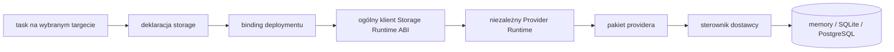

# M12 — niezależny Storage Runtime i providery

> **Status:** M12.1–M12.11 wykonane w opisanym zakresie; PostgreSQL live E2E oczekuje na serwer
>
> **Implementacja:** host i Abstractions w `junexis-runtime`; memory, SQLite i PostgreSQL w `junexis-storage-providers`
>
> **Składnia `storage`:** DESIGN PROPOSAL, nie należy jeszcze do gramatyki
>
> **Decyzje:** D16, D17, D21

## Cel

Ten sam program Junexis ma korzystać z memory, SQLite albo PostgreSQL przez
jawny binding, niezależnie od języka wykonującego target. Zmiana backendu
`@server` z Go na C#, Javę lub Python nie może wymagać ponownego napisania
providera bazy.

```text
program Junexis
    → deklaracja storage
    → binding deploymentu
    → ogólny klient Storage Runtime ABI
    → niezależny Provider Runtime
    → provider
    → sterownik dostawcy
    → zasób
```

## Słownik M12

| Pojęcie | Odpowiedzialność | Nie oznacza |
|---|---|---|
| target | logiczne miejsce wykonania, np. `@server` | języka generatora |
| backend | implementacja wykonania targetu, np. Go lub C# | providera danych |
| deklaracja storage | nazwa zasobu, operacje, typy, efekty i wymagania | connection stringa ani drivera |
| provider | technologia i capabilities, np. PostgreSQL | kodu domenowego |
| driver | biblioteka używana przez provider, np. Npgsql | kontraktu Junexis |
| Provider Runtime | host wykonujący pakiety providerów | platformy `@server` |
| binding | jawny wybór providera i konfiguracji dla środowiska | deklaracji protokołu |
| protocol | komunikacja logicznych elementów systemu | technicznego ABI storage |

Żadne z tych pojęć nie może być używane jako skrót innego. W szczególności
„provider dla `@server`” jest nieprecyzyjne. Poprawne określenie brzmi:
„provider związany z deklaracją storage używaną przez zadanie umieszczone na
`@server`”.

## Granice własności



- task zna typowane operacje, nie zna providera,
- deklaracja zna efekty i wynik, nie zna placementu implementacji providera,
- binding zna wybrane środowisko i odwołanie do sekretu,
- Provider Runtime zna ABI oraz pakiet providera, nie zna domeny,
- provider zna capabilities technologii,
- driver zna natywne API bazy, ale nie zna Junexis.

## Deklaracja storage

Poniższy zapis jest pseudokodem projektowym. M12.1 zamraża znaczenie, nie
gramatykę:

```junexis
storage HomeData {
    operation LatestObservations {
        effect = read
        handler = home::storage::latest_observations
    }

    operation SaveObservation {
        effect = write
        handler = home::storage::save_observation
    }
}
```

Deklaracja nie zawiera:

- `target server`,
- `language go`,
- ścieżki do pliku C#, Go, Java lub Python,
- nazwy Npgsql, pgx albo JDBC,
- adresu bazy i poświadczeń.

Może być używana przez task umieszczony na dowolnym targecie, jeżeli binding,
profil środowiska i polityka bezpieczeństwa pozwalają na dostęp do jej
Provider Runtime.

## Operacje

Minimalny katalog efektów M12:

| Efekt | Znaczenie |
|---|---|
| `read` | odczyt bez zmiany trwałego stanu |
| `write` | utworzenie lub zmiana danych |
| `delete` | jawne usunięcie danych |
| `transaction` | kontrola atomowej granicy operacji |
| `migration` | wersjonowana zmiana schematu |
| `health` | sprawdzenie gotowości zasobu |

`GET` i `POST` nie należą do tego katalogu: są pojęciami HTTP i pozostają w
deklaracji `protocol`, jeżeli system rzeczywiście wystawia HTTP.

M12 ma również dopuścić jawne operacje natywne:

- `query` — rekord lub kolekcja,
- `scalar` — pojedyncza wartość,
- `command` — skutek zapisu i liczba zmienionych rekordów,
- sekwencyjne źródło wyniku — bez utożsamienia z komunikacyjnym `stream<T>`.

Wartości zapytania są zawsze bindowanymi parametrami. Dynamiczne składanie SQL
z danych użytkownika nie jest zgodną implementacją providera.

## Provider i driver

Provider jest pakietem Junexis, który deklaruje:

- stabilne ID oraz wersję pakietu,
- zgodną wersję Storage Runtime ABI,
- rodzaj zasobu i capabilities,
- wersje serwera bazy, z którymi jest zgodny,
- runtime i entrypoint,
- nazwę i wersję natywnego drivera,
- schemat jawnej konfiguracji bez wartości sekretów,
- testy zgodności.

Należy rozróżnić cztery wersje:

```text
storage ABI version
provider package version
database server compatibility
native driver version
```

Przykładowo PostgreSQL 16, provider `0.1.0`, ABI `0.1` i Npgsql `10.x` są
czterema różnymi informacjami.

## Binding

Binding jest częścią projektu lub profilu deploymentu. Pseudokod manifestu:

```toml
[storage.home]
declaration = "HomeData"
provider = "postgresql"
providerVersion = "0.1.0"
connection = "secret:home-postgresql"
```

Binding podlega walidacji przed uruchomieniem:

1. provider istnieje i jego pakiet jest integralny,
2. wersja ABI jest zgodna,
3. capabilities spełniają wymagania deklaracji,
4. profil środowiska pozwala uruchomić Provider Runtime,
5. odwołanie do sekretu istnieje, lecz jego wartość nie trafia do artefaktów,
6. dokładne wersje i hashe są zapisane w lockfile.

## Provider Runtime ABI

Provider Runtime jest techniczną granicą wykonania, ale nie publicznym
`protocol` aplikacji. Pierwsza implementacja referencyjna będzie hostem .NET,
aby provider PostgreSQL mógł użyć Npgsql, a SQLite dojrzałego drivera .NET.

ABI musi obejmować:

- handshake i negocjację wersji,
- listę capabilities,
- otwarcie oraz zamknięcie bindingu,
- health check,
- wywołanie operacji i typowany wynik,
- begin, commit oraz rollback,
- deadline i anulowanie,
- sekwencyjny odczyt większych wyników,
- stabilne klasy błędów `junexis.storage/0.1`,
- bezpieczną telemetrię i korelację Narrative.

Koszt granicy nie może być ukrywany. Deployment i artefakty analizy pokażą,
czy runtime działa in-process, jako proces lokalny czy jako zarządzana usługa.

## Relacja z istniejącym `protocol`

`protocol` wiąże logiczne elementy systemu, na przykład task `@server` z
panelem `@report`. Storage Runtime ABI obsługuje wykonanie zasobu. Nie dodajemy
automatycznie deklaracji `protocol storage` i nie zapisujemy metod bazy jako
GET/POST.

Jeżeli architekt świadomie wystawi storage jako osobną usługę domenową, wtedy
ta usługa posiada własne taski i zwykły kontrakt `protocol`. Jest to inna
architektura niż lokalny Provider Runtime.

## Bootstrap M11

Aktualne `extern storage`, `storage.Store` oraz generowane pakiety Go dla
Memory, SQLite i PostgreSQL są niezależnymi pakietami Runtime. Generator Go nie
zawiera ich implementacji. Golden Storage E2E działa przez neutralnego klienta,
zweryfikowany lockfile i osobny host.

## Etapy M12

| Etap | Rezultat | Status |
|---|---|---|
| M12.1 | pojęcia, granice, ADR D21 i kontrakt architektoniczny | ACCEPTED |
| M12.2 | manifest pakietu providera, binding i lockfile | VERIFIED |
| M12.3 | Storage Runtime ABI i szkielet hosta .NET | VERIFIED BASELINE |
| M12.4 | provider memory poza generatorem targetu | VERIFIED |
| M12.5 | provider SQLite poza generatorem targetu | VERIFIED |
| M12.6 | PostgreSQL, native SQL i mapowanie typowanych wyników | CONTRACT VERIFIED; LIVE E2E PENDING |
| M12.7 | wspólna bramka zgodności i Golden Storage E2E | VERIFIED |
| M12.8 | launcher lockfile i provider wewnątrz System Bundle | VERIFIED |
| M12.9 | ścieżki Laboratorium Junexis dla storage | VERIFIED |
| M12.10 | niezależne repozytorium i bramka wydawnicza providerów | VERIFIED WORKSPACE |
| M12.11 | wersjonowane paczki Runtime SDK i brak cross-repo ProjectReference | VERIFIED LOCAL FEED |

## Kryteria odbioru całego M12

1. ten sam program `.jnx` działa z memory, SQLite i PostgreSQL przez zmianę
   bindingu,
2. zmiana backendu targetu nie wymaga zmiany pakietu providera,
3. żaden generator targetu nie zawiera implementacji konkretnej bazy,
4. nowy provider można dodać bez przebudowania kompilatora,
5. binding i lockfile zachowują dokładną tożsamość pakietu,
6. sekrety nie trafiają do źródeł, manifestów wynikowych ani telemetrii,
7. native SQL jest parametryzowany i ma jawny efekt oraz typ wyniku,
8. memory, SQLite i PostgreSQL przechodzą wspólną bramkę zgodności,
9. PostgreSQL przechodzi pełny E2E na rzeczywistym serwerze,
10. dokumentacja prowadzi przez `Poznaj`, `Eksperymentuj` i `Przejmij kontrolę`.
11. implementacje konkretnych baz nie należą do repo Runtime ani generatora.
12. provider można zbudować i przetestować z wersjonowanego SDK bez kompilowania źródeł Runtime.

## Poza M12

- abstrakcyjny ORM i pełny Query Plan IR — M13,
- transakcje rozproszone pomiędzy providerami,
- automatyczne administrowanie serwerem bazy,
- backup, replikacja, HA i sharding,
- publiczny rejestr providerów,
- optymalizacja in-process omijająca referencyjne ABI.
